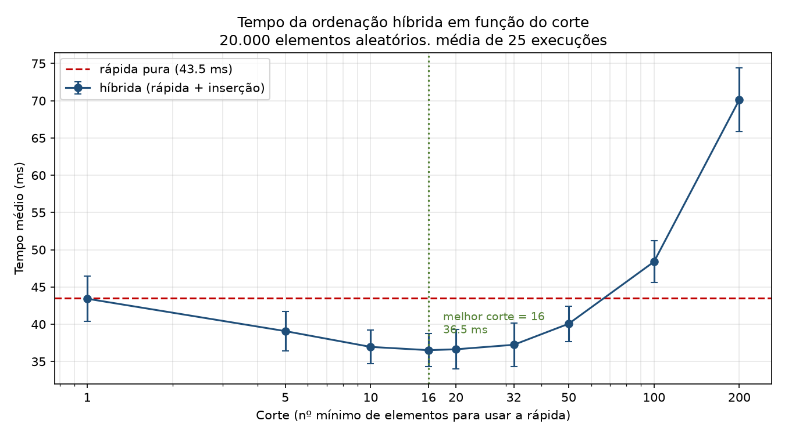

# Relatório: a ordenação híbrida (rápida + inserção)

## 1. Objetivo

O objetivo deste trabalho é construir uma ordenação **híbrida**, que usa a
ordenação rápida para pedaços grandes e a ordenação por inserção para pedaços
pequenos, e **descobrir onde fica o ponto de troca** entre os dois métodos.
Esse ponto de troca é o parâmetro `corte`: sempre que um pedaço tiver menos que
`corte` elementos, a inserção assume o serviço.

Para isso comparamos a versão híbrida com a ordenação rápida pura, medindo o
tempo sobre 20 mil elementos aleatórios e variando o corte entre
`1, 5, 10, 16, 20, 32, 50, 100` e `200`.

## 2. Implementação

### 2.1 Ordenação rápida com pivô aleatório e três vias

A ordenação rápida foi implementada em `src/ordenacoes.py`. O pivô é escolhido
**aleatoriamente** e a partição separa o vetor em **três** regiões: os menores
que o pivô, os iguais e os maiores. A partição de três vias é uma escolha
deliberada: ela faz com que elementos repetidos caiam todos de uma vez na
região dos "iguais", em vez de serem reparticionados indefinidamente. Isso
elimina o pior caso quando há muitas repetições no vetor.

Como o pivô é sorteado, a probabilidade de cairmos em uma sequência de
partições muito desequilibradas fica desprezível, e o comportamento se
aproxima do caso médio `O(n log n)`. Na recursão, chamamos primeiro o **lado
menor** e resolvemos o lado maior por laço, o que limita a profundidade da
pilha a `O(log n)` e evita estouro de recursão.

### 2.2 A parte híbrida e o parâmetro `corte`

A função `quicksort_hibrido(lista, corte, rng)` é a mesma ordenação rápida com
uma única decisão extra: antes de particionar um pedaço, verificamos o seu
tamanho. Se ele tiver **menos que `corte` elementos**, entregamos o pedaço para
`insercao(lista, inicio, fim)` e retornamos. Caso contrário, seguimos com a
partição de três vias normalmente.

O `corte` é um parâmetro da função, não uma constante escondida no código, o
que permite estudar como o tempo varia com ele. A função de inserção atua
diretamente sobre o intervalo `[inicio, fim]` do próprio vetor, sem copiar
dados, então a troca de método não introduz custo de cópia.

### 2.3 Correção

Há testes em `tests/test_ordenacoes.py` cobrindo vetores vazios, de um elemento,
já ordenados, invertidos, com muitos empates e aleatórios, para todos os cortes
estudados. Além disso, o próprio experimento confere, a cada medição, que o
vetor foi realmente ordenado — o tempo só é contabilizado se o resultado
estiver correto.

## 3. Metodologia

O experimento está em `src/benchmark.py` e segue uma rotina cuidadosa, porque
as diferenças de tempo envolvidas são pequenas:

- **Entrada:** 20.000 números inteiros aleatórios. A mesma entrada é reutilizada
  por todos os algoritmos, para que a comparação não dependa da sorte do vetor.
- **Repetições:** 25 vetores distintos por configuração, com médias reportadas
  junto do desvio padrão e do menor tempo.
- **Comparação justa:** o sorteio dos pivôs usa a mesma semente em todas as
  configurações de uma rodada.
- **Rodadas intercaladas:** em cada rodada, todas as configurações ordenam o
  *mesmo* vetor, em ordem rotacionada. Isso evita o viés de aquecimento, em que
  a primeira configuração medida aparece artificialmente lenta. Antes das
  medições há ainda uma fase de aquecimento.
- **Ambiente:** AMD Ryzen 7 7735HS, 16 núcleos, Python 3.13.5, Linux (WSL2).

O gráfico e a tabela a seguir vêm exatamente dessas medições (arquivos
`resultados/tempo_vs_corte.png` e `resultados/tabela.md`).

## 4. Resultados

### 4.1 Tabela

| Configuração | Tempo médio (ms) | Desvio padrão (ms) | Mínimo (ms) | Ganho vs. pura (%) |
| --- | ---: | ---: | ---: | ---: |
| rápida pura | 43,54 | 4,13 | 38,78 | +0,0 |
| híbrida, corte = 1 | 43,42 | 3,03 | 39,10 | +0,3 |
| híbrida, corte = 5 | 39,08 | 2,63 | 35,59 | +10,2 |
| híbrida, corte = 10 | 36,96 | 2,25 | 33,22 | +15,1 |
| **híbrida, corte = 16** | **36,52** | 2,24 | 33,42 | **+16,1** |
| híbrida, corte = 20 | 36,64 | 2,65 | 32,95 | +15,8 |
| híbrida, corte = 32 | 37,24 | 2,89 | 32,70 | +14,5 |
| híbrida, corte = 50 | 40,07 | 2,38 | 36,85 | +8,0 |
| híbrida, corte = 100 | 48,39 | 2,80 | 44,21 | −11,1 |
| híbrida, corte = 200 | 70,13 | 4,32 | 65,28 | −61,1 |

### 4.2 Gráfico

O gráfico mostra uma curva em forma de "U" com fundo largo e pouco profundo: o
tempo cai rapidamente de `corte = 1` até `corte = 10`, fica estável na faixa de
10 a 32 e volta a subir de forma acentuada a partir de `corte = 50`. A linha
vermelha tracejada marca o tempo da rápida pura, e a linha verde pontilhada
marca o melhor corte encontrado.

## 5. Análise

### 5.1 Qual corte deu o melhor tempo, e o ganho sobre a rápida pura

O melhor tempo foi obtido com **`corte = 16`**, com **36,52 ms** em média,
contra **43,54 ms** da rápida pura — um **ganho de 16,1%**, ou seja, cerca de
7 ms economizados em cada ordenação de 20 mil elementos.

É importante ser honesto quanto à precisão: os cortes 16, 20 e 32 produziram
36,52 ms, 36,64 ms e 37,24 ms, com desvios padrão de 2,2 a 2,9 ms. Essas
diferenças são **menores que o próprio ruído**, então não se pode afirmar que 16
seja melhor que 20 ou 32 — o que os dados sustentam é que existe um **platô
ótimo na faixa aproximada de 10 a 32**, e que qualquer valor nessa faixa entrega
ganhos de 14% a 16% sobre a rápida pura. A escolha de `corte = 16` como número
principal é, portanto, uma escolha dentro de uma faixa equivalente, e não um
ponto isolado claramente superior.

Vale notar também a diferença de tendência em relação à faixa de 1 a 10: ali a
melhora é grande e consistente, saindo de praticamente zero de ganho (corte = 1)
para 15% (corte = 10). O formato de "subida rápida, platô largo, queda brusca"
é justamente o que se espera desse tipo de otimização.

### 5.2 Por que a híbrida ganha da rápida pura

A ordenação rápida pura continua particionando até chegar a pedaços de 0 ou 1
elemento. Nos últimos níveis da recursão, ela gasta um número enorme de
chamadas de função e de partições para organizar pedaços minúsculos, onde o
custo fixo de cada chamada domina o trabalho útil.

A inserção, nesses pedaços pequenos, é mais barata: ela não tem chamadas de
função recursivas, não escolhe pivô e, para vetores curtos e quase ordenados
(como saem da partição), faz aproximadamente `n²/4` comparações simples com
constante baixa. Trocar as últimas camadas de recursão por inserção remove
justamente a parte da rápida com pior relação entre trabalho útil e sobrecarga.
Daí o ganho de cerca de 15%.

### 5.3 O que acontece com cortes grandes demais

Quando o corte cresce demais, a inserção deixa de ser usada apenas nos pedaços
minúsculos e passa a ordenar pedaços médios — e a inserção é **quadrática**. O
custo total da fase de inserção cresce de forma aproximadamente linear com o
corte: com pedaços de tamanho da ordem de `corte`, o total de comparações da
inserção é da ordem de `N · corte / 4`. Para `corte = 200`, isso dá cerca de
1 milhão de comparações, muito mais do que o custo total da própria ordenação
rápida, que é da ordem de `N · log₂ N ≈ 287 mil` comparações.

É exatamente o que os dados mostram: em `corte = 100` o tempo já passou a ser
**pior que a rápida pura** (−11,1%), e em `corte = 200` a degradação é severa,
com **70,13 ms**, isto é, **61,1% mais lento que a rápida pura**. O vetor de 20
mil elementos tem cerca de 20 mil pedaços potenciais de tamanho pequeno; se
cada um for resolvido por um método quadrático, o custo deixa de ser dominado
por `n log n` e passa a ser dominado pelos termos quadráticos dos pedaços.

Em resumo: **corte pequeno demais desperdiça a otimização; corte grande demais
transforma a híbrida em uma ordenação quadrática disfarçada.** O ponto de troca
precisa ficar na faixa em que a inserção só atua onde ela realmente é mais
rápida.

### 5.4 Confirmação de que `corte = 1` se comporta como a rápida pura

Com `corte = 1`, a condição de troca é "pedaço com menos de 1 elemento". Como
nenhum pedaço pode ter menos de 1 elemento, a inserção **nunca é chamada**: o
código passa a executar exatamente o mesmo caminho da ordenação rápida pura.

Essa equivalência foi confirmada de duas maneiras:

1. **No código** — instrumentando o contador de partições, as duas versões
   realizam exatamente o **mesmo número de partições** (12.832 para o vetor de
   teste), o que significa que tomam as mesmas decisões e fazem o mesmo
   trabalho.
2. **Nos tempos** — `corte = 1` mediu **43,42 ms**, contra **43,54 ms** da
   rápida pura. A diferença de 0,3% é muito menor que o desvio padrão das
   medições (3 a 4 ms), ou seja, está dentro do ruído. Estatisticamente, os
   dois são indistinguíveis.

Isso também serve de controle do experimento: se a curva caísse de `corte = 1`
para `corte = 5` por outro motivo que não a inserção nos pedaços pequenos, esse
controle não bateria com a rápida pura. Ele bate.

## 6. Conclusão

A ordenação híbrida compensa. Nas condições testadas — 20 mil elementos
aleatórios, em Python — o melhor desempenho ficou na faixa de **`corte` entre 10
e 32**, com destaque para `corte = 16` a **36,52 ms**, cerca de **15% a 16% mais
rápido que a ordenação rápida pura** (43,54 ms).

O formato do resultado é o esperado pela teoria: um platô largo de bons valores,
precedido por uma subida rápida de ganho (cortes de 1 a 10) e seguido por uma
degradação acentuada (cortes de 100 e 200), causada pelo custo quadrático da
inserção atuando sobre pedaços que já não são pequenos. Quando o corte é 1, a
híbrida recai exatamente sobre a rápida pura, o que foi confirmado tanto pelo
número idêntico de partições quanto pelos tempos medidos.

O ponto de troca não é um número mágico universal: ele depende da linguagem, da
máquina e até do custo relativo de chamada de função. Em Python, onde a
sobrecarga de chamada de função é alta, a faixa ótima apareceu nessa região de
10 a 32; em linguagens compiladas de baixo nível, o valor costuma ser menor,
justamente porque a sobrecarga por chamada é mais barata.
